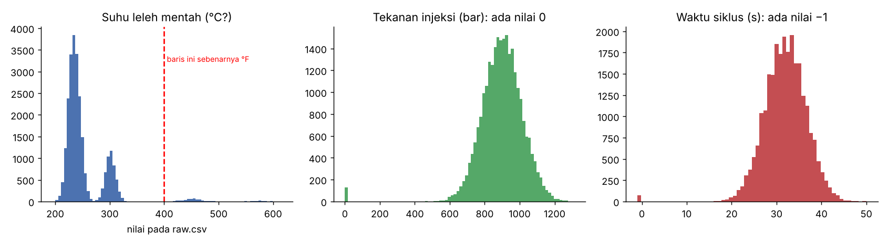
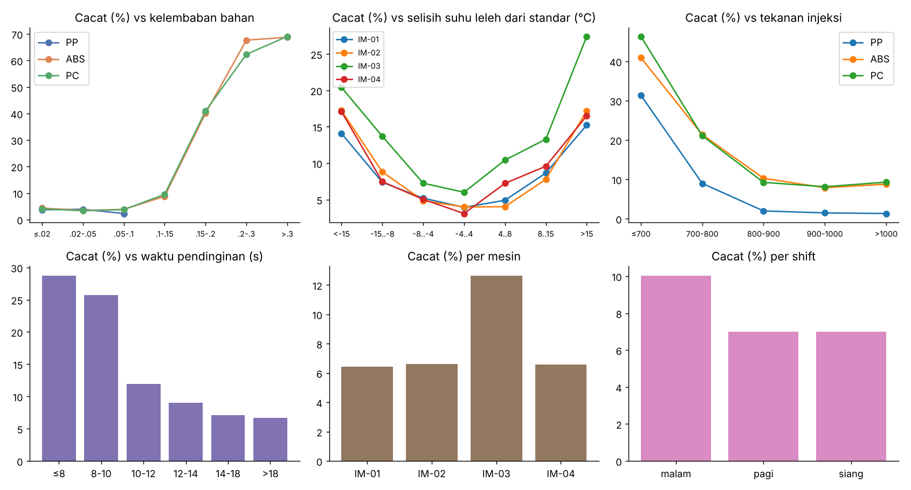
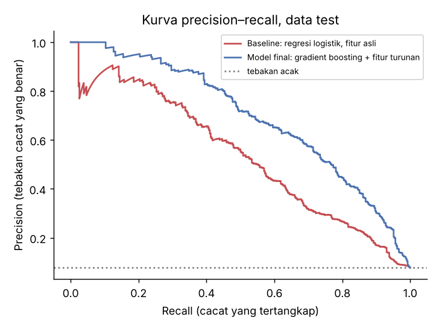
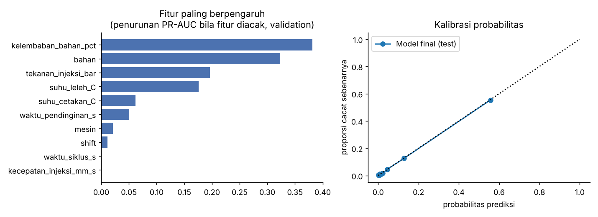
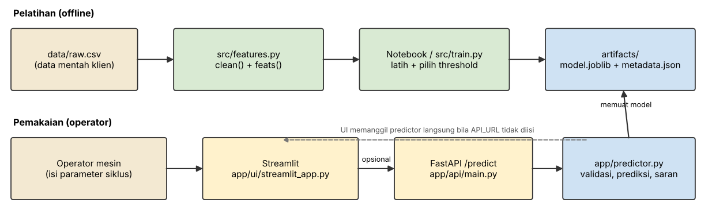

# Laporan Kasus 01 · Pengendalian Mutu *Injection Molding*

Tim 01 

Navanza Varel 2409181

Melinda Azalia Fausta 2407608 

## 1. Masalah

**Klien dan pengguna.** Klien adalah kepala bagian QC sebuah pabrik komponen plastik (tutup botol, rumah komponen, klip) di Cikarang. Pengguna aplikasi adalah operator mesin di lantai produksi.

**Keputusan yang dibantu.** Cacat baru ketahuan saat inspeksi visual di akhir *shift*. Model menerima parameter satu siklus cetak dan memberi probabilitas komponen cacat, sehingga operator bisa menyisihkan komponen yang dicurigai dan memperbaiki pengaturan mesin sebelum ratusan komponen lain ikut cacat. Dua kesalahan berbeda biayanya: komponen cacat yang lolos ke pelanggan merugikan **Rp500.000** (klaim dan reputasi), sedangkan komponen bagus yang ikut disisihkan merugikan **Rp25.000**. Melewatkan cacat 20 kali lebih mahal, sehingga model yang "kebanyakan waspada" lebih dapat diterima daripada yang "kebobolan".

**Metrik dan baseline.** Metrik utama adalah PR-AUC, karena cacat hanya 7,8% dan akurasi akan menyesatkan (menebak "tidak cacat" untuk semuanya sudah 92% akurat). PR-AUC mengukur seberapa baik komponen cacat diberi peringkat di atas yang bagus, dan nilai tebakan acak sama dengan tingkat cacat (0,078). *Baseline* wajib adalah regresi logistik dengan fitur asli.

## 2. Data

`raw.csv` berisi 25.350 siklus cetak dari mesin IM-01 sampai IM-04, Maret–Juni 2026. Kolom penting: bahan (PP, ABS, PC), suhu leleh dan suhu cetakan, tekanan dan kecepatan injeksi, waktu pendinginan dan waktu siklus, kelembaban bahan, serta target `cacat`.

**Tabel masalah data** (setelah pembersihan tersisa 25.000 baris, 7,76% cacat):

| Masalah | Baris | Penanganan dan alasan |
|---|---|---|
| Duplikat persis | 350 | Dibuang **sebelum** pembagian data; salinan yang sama di *train* dan *test* membuat skor terlalu bagus. |
| `bahan` dengan 11 ejaan | 750 | Dinormalkan menjadi PP/ABS/PC; kalau tidak, "pp" dan "PP" dianggap bahan berbeda. |
| `shift` dengan ejaan campur | 500 | Strip dan huruf kecil. |
| Suhu leleh dalam °F (384–615) | 579 | Dikonversi. Setelah konversi sebarannya jatuh di sekitar 230/240/300 °C sesuai suhu standar tiap bahan, jadi ini bukan kerusakan sensor dan tidak dibuang. |
| Tekanan = 0 | 125 | Tidak mungkin pada siklus injeksi; dianggap sensor rusak, diganti kosong. |
| Waktu siklus = −1 | 75 | Penanda hilang, diganti kosong. |
| Pendinginan kosong / kelembaban kosong | 250 / 1.000 | Imputasi median di dalam *pipeline* (dihitung dari *train*). Kekosongan tersebar rata dan tingkat cacatnya mirip rata-rata. |

Tambahan: kolom `shift` tidak cocok dengan jam produksi (label "pagi" muncul tengah malam), jadi perlu dikonfirmasi ke klien.

**Temuan EDA yang paling berpengaruh** (grafik di bawah):

1. **Kelembaban bahan hanya berbahaya untuk ABS dan PC.** Cacat sekitar 4% bila kelembaban ≤0,1%, naik menjadi ±19% pada 0,1–0,2%, dan ±65% di atas 0,2%. PP praktis tidak pernah lembab. Ini konsisten dengan *silver streak* di brief.
2. **Suhu berbentuk U terhadap standar bahan.** Terlalu panas dan terlalu dingin sama-sama menaikkan cacat. Suhu "normal" PP dan PC berbeda 70 °C, jadi yang informatif adalah selisih dari standar bahan, bukan suhu mentah.
3. **Tekanan rendah dan pendinginan pendek.** Tekanan di bawah 700 bar menghasilkan cacat 37%, dan pendinginan ≤10 detik 26–29%; di atas ambang itu kurvanya mendatar. Mesin **IM-03** (suhu leleh rata-rata +6 °C di atas standar) cacat 12,6% dibanding 6,4–6,6% pada mesin lain, dan shift malam 10% dibanding 7%.

## 3. Metode

**Fitur.** Dibuat di `src/features.py` agar identik saat pelatihan dan prediksi: selisih suhu leleh dan suhu cetakan terhadap standar bahan (beserta nilai mutlaknya), penanda bahan higroskopis, kelembaban × higroskopis dan kelebihannya di atas 0,1%, kekurangan tekanan dari 900 bar, kekurangan pendinginan dari 12 detik, dan penanda tekanan tidak tercatat. Alasannya: model linear tidak bisa menangkap kurva U dan efek yang hanya berlaku untuk bahan tertentu.

**Pembagian data.** *Stratified* acak 60/20/20 (15.000/5.000/5.000, masing-masing 7,76% cacat, seperti diminta brief). Ini berarti model menilai siklus yang bercampur waktunya dengan data latih; sebagai uji tambahan (analisis terpisah di luar notebook), melatih Maret–Mei dan menguji Juni memberi kesimpulan yang sama: model final tetap jauh di atas *baseline*.

**Model.** (a) *Baseline* regresi logistik, fitur asli. (b) Regresi logistik dengan fitur turunan. (c) *Histogram gradient boosting* dengan fitur turunan; 24 kombinasi *hyperparameter* dicoba dan dipilih dengan PR-AUC *validation* (*learning rate* 0,06, 8 daun, minimum 60 sampel per daun, L2 = 3,0, berhenti dini).

**Pemilihan model dan *threshold*.** Model dipilih dengan PR-AUC *validation*. *Threshold* dipilih dengan memindai nilai 0,5%–95% di *validation* dan meminimalkan biaya `500.000 × (cacat lolos) + 25.000 × (bagus tersisih)`. Data *test* dibuka sekali setelah keduanya ditetapkan.

## 4. Hasil

| Model | PR-AUC *validation* | PR-AUC *test* |
|---|---|---|
| *Baseline*: regresi logistik, fitur asli | 0,483 | 0,536 |
| Regresi logistik + fitur turunan | 0,629 | n/a |
| ***Gradient boosting* + fitur turunan (final)** | **0,649** | **0,698** |

Model final mengungguli *baseline* sekitar +0,16 PR-AUC pada data *test*. Sebagian besar lonjakan berasal dari fitur turunan (regresi logistik naik dari 0,483 ke 0,629 di *validation*); *boosting* menambah sekitar 0,02 lagi. Tiap bagian data hanya berisi 388 komponen cacat, sehingga angka *test* bisa bergeser sekitar ±0,04–0,05 karena sampel saja. Selisih terhadap *baseline* jauh melampaui itu, tetapi selisih antar model yang berdekatan belum pasti. Angka di atas berasal dari notebook yang dijalankan di Google Colab; versi scikit-learn lain dapat menggeser angka di belakang koma.

**Threshold = 4,25%**, dipilih dari pemindaian biaya di *validation*, dan dekat dengan titik impas teoretis 25.000/525.000 = 4,76% (komponen disisihkan bila probabilitas cacatnya di atas sekitar 4–5%, jauh di bawah 50% karena melewatkan satu cacat 20 kali lebih mahal). Hasil pada *test* (5.000 komponen, 388 cacat):

| Strategi | Cacat lolos | Bagus tersisih | Recall | Disisihkan | Biaya total | Per 1.000 komponen |
|---|---|---|---|---|---|---|
| Loloskan semua | 388 | 0 | 0% | 0% | Rp194,0 jt | Rp38,8 jt |
| Sisihkan semua | 0 | 4.612 | 100% | 100% | Rp115,3 jt | Rp23,1 jt |
| *Baseline*, threshold 4,25% | 42 | 1.563 | 89,2% | 38,2% | Rp60,1 jt | Rp12,0 jt |
| **Model final, threshold 4,25%** | **34** | **915** | **91,2%** | **25,4%** | **Rp39,9 jt** | **Rp8,0 jt** |

Model final menghemat sekitar Rp20 juta per 5.000 komponen dibanding *baseline* (±34%) dan sekitar Rp75 juta dibanding menyisihkan semuanya. Dari tiap 10 komponen yang ditandai, sekitar 3 benar-benar cacat, dan sekitar 1 dari 11 komponen cacat lolos tanpa tertandai. Bila angka kerugian berubah, hanya *threshold* yang perlu digeser, bukan modelnya.

**Fitur paling berpengaruh** (*permutation importance*, penurunan PR-AUC *validation*): kelembaban bahan (0,38), bahan (0,33), tekanan injeksi (0,20), suhu leleh (0,18), suhu cetakan (0,07), waktu pendinginan (0,05), mesin (0,02), shift (0,01); kecepatan injeksi dan waktu siklus hampir nol. Ini masuk akal: kelembaban, tekanan, suhu, dan pendinginan memang parameter yang diketahui memengaruhi mutu cetak, sedangkan waktu siklus sebagian besar mengulang informasi pendinginan (korelasi 0,83). Bahan tinggi karena menentukan suhu standar dan apakah kelembaban relevan. Model paling lemah pada PP karena cacatnya hanya 3,3% dan pemicunya sedikit.

## 5. Aplikasi

**Arsitektur.** Data mentah dibersihkan dan diberi fitur oleh `src/features.py`; notebook atau `src/train.py` melatih model dan menyimpan `artifacts/model.joblib` serta `metadata.json` (versi, fitur masukan, *threshold*, metrik, rentang data latih). Modul `app/predictor.py` memuat model, memvalidasi masukan, menghitung probabilitas, dan menyusun saran. Modul itu dipakai oleh API FastAPI (`POST /predict`, `/info`, `/health`) dan oleh aplikasi Streamlit untuk operator. Fungsi pembersihan yang sama dipakai saat pelatihan dan saat prediksi, sehingga masukan operator diperlakukan persis seperti data latih (misalnya suhu °F dikonversi, tekanan 0 dianggap sensor rusak).

**Masukan dan keluaran.** Operator memilih mesin, bahan, dan shift, lalu mengisi suhu leleh, suhu cetakan, tekanan, kecepatan, pendinginan, siklus, dan kelembaban. Keluarannya: probabilitas cacat, keputusan (lolos / sisihkan), peringatan, dan saran tindakan. Setiap saran diuji dengan model: "bila hanya tindakan ini dilakukan, probabilitas turun menjadi sekian". Contoh:

| Masukan | Keluaran |
|---|---|
| PP, IM-01, pagi, 230 °C / 40 °C, 950 bar, pendinginan 18 s, kelembaban 0,02% | Probabilitas cacat ≈ 0,1% → **LOLOS** |
| ABS, IM-03, malam, 255 °C / 62 °C, 760 bar, pendinginan 11 s, kelembaban 0,18% | Probabilitas cacat ≈ 94% → **SISIHKAN**. Saran: keringkan bahan (→ ≈ 49%), turunkan suhu leleh ke 240 °C (→ ≈ 69%), naikkan tekanan ke ≥ 950 bar (→ ≈ 87%), perpanjang pendinginan ke ≥ 14 s (→ ≈ 91%); bila semuanya dilakukan ≈ 0,4%. Catatan: periksa sensor dan pemanas IM-03. |

*(Angka contoh dari model yang dilatih di repositori; model hasil Colab memberi angka serupa.)*

[Tempel tangkapan layar aplikasi di sini: satu untuk masukan normal, satu untuk masukan berisiko.]

**Penanganan masukan tidak wajar** (diuji otomatis di `tests/test_predictor.py`, 12 uji):

| Masukan | Perilaku aplikasi |
|---|---|
| Kolom wajib kosong, atau teks seperti "abc" | Ditolak dengan pesan per kolom; tidak ada prediksi dan aplikasi tidak berhenti. |
| Angka mustahil (suhu leleh 9999 °C, kelembaban −3%) | Ditolak, dengan batas yang wajar dan petunjuk memeriksa satuan atau salah ketik. |
| Kolom opsional kosong (tekanan, pendinginan, siklus, kelembaban) | Tetap diprediksi dengan nilai tengah data latih, disertai peringatan bahwa prediksi kurang pasti. |
| Suhu leleh dalam °F (mis. 446 untuk PP) | Dikenali dan dikonversi, dengan peringatan. |
| Tekanan 0 atau waktu siklus ≤ 0 | Dianggap sensor rusak (sama seperti saat pelatihan), dengan peringatan. |
| Nilai valid tetapi di luar rentang data latih | Tetap dihitung, disertai peringatan bahwa model belum pernah melihat rentang itu. |
| Desimal berkoma ("0,18"), ejaan bahan berbeda (" p.p ") | Dinormalkan seperti pada pembersihan data. |
| Mesin atau bahan yang tidak dikenal | Ditolak dengan daftar pilihan yang valid. |

Bila versi scikit-learn di tempat aplikasi dijalankan berbeda dari versi saat model dilatih, aplikasi melatih ulang model dari `data/raw.csv` saat dinyalakan, bukan error. Aplikasi: [tautan, isi setelah *deploy*].

## 6. Keterbatasan dan langkah berikutnya

**Kapan model tidak dapat dipercaya.**
- Mesin, bahan, atau musim yang tidak ada di data (4 mesin, 4 bulan); parameter di luar rentang yang pernah dilihat.
- Untuk PP, karena cacatnya jarang dan pemicunya sedikit, peringkatnya jauh kurang tajam.
- Saran tindakan di aplikasi berasal dari aturan sederhana yang dibuat dari pola data (ambang kelembaban, tekanan, suhu, pendinginan), bukan dari hubungan sebab-akibat yang terbukti.
- Model menemukan hubungan, bukan sebab. "Kelembaban tinggi pada ABS → cacat" sesuai teori proses, tetapi saran tindakan ke operator (keringkan bahan, naikkan tekanan, perpanjang pendinginan) perlu divalidasi tim proses.
- Kolom `shift` tidak konsisten dengan jam produksi. Bila ternyata hanya artefak pencatatan, efek shift malam (10% vs 7%) tidak boleh diandalkan dan model perlu dilatih ulang tanpa kolom itu.
- Suhu leleh IM-03 rata-rata +6 °C di atas standar dan cacatnya tetap lebih tinggi pada setiap rentang suhu; ini perlu pengecekan fisik (sensor, pemanas *barrel*, cetakan), bukan hanya koreksi model.

**Yang perlu dipantau jika dipakai sungguhan.** Tingkat cacat aktual dibanding yang diprediksi (kalibrasi), PR-AUC bulanan dari hasil inspeksi, proporsi masukan yang kosong atau di luar rentang (tanda sensor atau satuan bermasalah), dan sebaran parameter per mesin. Sumber nilai °F dan tekanan 0 perlu diperbaiki di sistem klien, dan *threshold* ditinjau ulang bila angka kerugian berubah.

## Lampiran

- Tautan repositori: [https://github.com/melindaazalia-code/mkb-kasus01-injection-moldingg/blob/main/README.md ] · aplikasi: [https://mkb-kasus01-injection-moldingg-syjvmepvrmsdcq4khzpory.streamlit.app/ ] · video: [ ]
- Pembagian kerja: | Navanza Varel | 2409181 | [Data dan model: pemeriksaan dan pembersihan data, EDA, fitur turunan (src/features.py), baseline dan model final, pemilihan threshold dari biaya, notebook, src/train.py, artifacts] |
| Melinda Azalia Fausta | 2407608 | Aplikasi dan penyajian: app/predictor.py, API FastAPI, aplikasi Streamlit, pengujian (tests/), deploy dan repositori GitHub, penyusunan laporan, video |
- Penggunaan asisten AI: [diisi tim sendiri sesuai kenyataan; sebutkan bagian mana saja (misalnya kode pembersihan, pelatihan model, aplikasi, draf laporan) dan apa yang diperiksa atau diubah tim]
